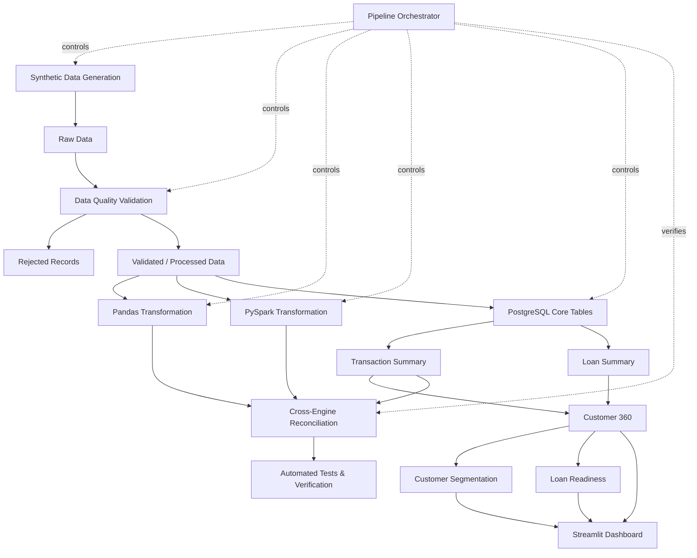

# Financial Customer Intelligence

An end-to-end data engineering and analytics pipeline that transforms raw financial data into validated, customer-level intelligence using Python, SQL, PostgreSQL, Pandas, PySpark, and Streamlit.

The system integrates customer, account, transaction, and loan data to build a consolidated analytical layer for understanding financial behaviour, customer segments, and loan readiness.

> **Data note:** The project uses programmatically generated financial data. No real customer or banking data is used.

---

## Problem Statement

Financial institutions generate data across customers, bank accounts, transactions, and loans. These operational records are useful individually, but they do not directly provide a consolidated view of customer financial behaviour.

Answering questions such as the following requires data from multiple sources to be validated, joined, aggregated, and interpreted:

- How much money flows into and out of a customer's accounts?
- How consistently does a customer spend?
- What proportion of income is committed to existing loan repayments?
- Which customers exhibit similar financial behaviour?
- Can transparent financial indicators provide an explainable assessment of loan readiness?

This project builds a reproducible pipeline that transforms raw financial records into a trusted customer-level analytical layer for answering these questions.

---

## Architecture



The complete workflow is orchestrated by `src/run_pipeline.py`. Pipeline stages execute in dependency order and fail immediately when an upstream generation, validation, transformation, loading, reconciliation, or testing stage fails.

---

## Tech Stack

| Technology | Role |
|---|---|
| Python | Data generation, validation, orchestration, and reconciliation |
| Pandas | Customer-level transaction transformations |
| PySpark | Distributed-style customer metrics transformation |
| PostgreSQL | Relational storage and analytical data layer |
| SQL | Aggregation, Customer 360, segmentation, and readiness logic |
| psycopg | PostgreSQL connectivity and bulk data loading |
| pytest | Automated validation and transformation testing |
| Streamlit | Interactive customer intelligence dashboard |
| Git / GitHub | Version control and project history |

---

## Data Model

The pipeline integrates four core entities:

```text
Customer
   |
   | 1:N
   v
Account
   |
   | 1:N
   v
Transaction

Customer
   |
   | 1:N
   v
Loan
```

### Customer

Stores customer attributes used throughout the analytical layer, including age, city, occupation, annual income, and join date.

### Account

Represents customer-owned financial accounts with account type, balance, open date, and status.

### Transaction

Captures CREDIT and DEBIT activity associated with customer accounts, including transaction date, category, and amount.

### Loan

Represents customer borrowing information including loan type, principal, interest rate, EMI, outstanding principal, and loan status.

Detailed column definitions and relationships are available in [`docs/data_model.md`](docs/data_model.md).

---

## Data Pipeline

### 1. Data Generation

Python generators create customer, account, transaction, and loan source datasets.

Fixed random seeds make generation deterministic, allowing the same source data and downstream results to be reproduced across pipeline runs.

### 2. Data Quality Validation

Raw datasets pass through validation before downstream processing.

Checks include:

- required identifiers
- duplicate identifiers
- valid customer-account relationships
- valid account-transaction relationships
- valid dates
- accepted categorical values
- positive financial amounts
- loan attribute consistency
- referential integrity

Valid records are written to `data/processed`, while rejected records are isolated in `data/rejected` for investigation.

Validation rules are documented in [`docs/data_quality_rules.md`](docs/data_quality_rules.md).

### 3. PostgreSQL Loading

Validated records are loaded into normalized PostgreSQL tables.

The database loader:

1. creates the required schema,
2. clears data from previous pipeline executions,
3. loads validated datasets,
4. executes analytical SQL transformations in dependency order,
5. verifies core and analytical outputs.

### 4. Analytical Transformation

SQL transformations convert operational records into customer-level features through:

```text
Core Tables
    |
    +--> Customer Transaction Summary
    |
    +--> Customer Loan Summary
              |
              v
         Customer 360
          /        \
         v          v
  Segmentation   Loan Readiness
```

The resulting analytical layer powers the Streamlit dashboard.

---

## Customer Transaction Metrics

Transaction activity is aggregated from individual accounts to the customer level.

| Metric | Description |
|---|---|
| `account_count` | Number of accounts owned by the customer |
| `total_credit` | Total incoming transaction amount |
| `total_debit` | Total outgoing transaction amount |
| `net_cash_flow` | Total credit minus total debit |
| `spending_ratio` | Total debit divided by total credit |
| `transaction_count` | Number of customer transactions |
| `spending_variability` | Variation in monthly debit spending |

These metrics form the behavioural foundation of the customer intelligence layer.

---

## Pandas and PySpark Transformations

Customer transaction metrics are independently implemented using both Pandas and PySpark.

### Pandas

The Pandas pipeline performs customer-level aggregation and produces a processed customer metrics dataset.

### PySpark

The PySpark implementation performs the same transformation using Spark operations including:

- explicit schemas
- account-to-customer ownership joins
- conditional CREDIT and DEBIT aggregation
- customer-level grouping
- monthly debit aggregation
- sample standard deviation
- left joins that preserve customers without transaction activity

Implementing the transformation through two processing engines also enables independent result verification.

---

## Cross-Engine Reconciliation

A reconciliation layer verifies that independently calculated customer metrics remain consistent across:

```text
Pandas
   \
    \
     +--> Reconciliation
    /
PySpark
    \
     \
      PostgreSQL
```

The reconciliation process validates:

- customer identifiers
- integer metrics
- financial aggregations
- spending ratios
- spending variability

Integer metrics are compared exactly.

Floating-point metrics are compared using a small numerical tolerance to account for representation differences between processing engines.

The project performs:

- Pandas ↔ PostgreSQL reconciliation
- Pandas ↔ PySpark reconciliation
- PySpark ↔ PostgreSQL reconciliation

A mismatch causes reconciliation to fail rather than allowing inconsistent analytical results to pass silently.

---

## Customer 360

The `customer_360` PostgreSQL view combines customer attributes with transaction and loan metrics to produce one analytical record per customer.

The view includes:

- age
- city
- occupation
- annual income
- join date
- account count
- total credit
- total debit
- net cash flow
- spending ratio
- spending variability
- transaction count
- active loan count
- total outstanding loan amount
- monthly EMI obligation
- debt-to-income ratio

This view acts as the consolidated analytical foundation for customer segmentation, loan-readiness analysis, and dashboard exploration.

---

## Customer Segmentation

Customers are grouped into interpretable behavioural segments using financial characteristics from the Customer 360 layer.

Current segments include:

| Segment | General Interpretation |
|---|---|
| `FINANCIALLY_STRONG` | Strong cash-flow margin, controlled spending, and manageable debt |
| `STABLE` | Healthy cash flow with manageable debt |
| `HIGH_SPENDER` | High proportion of incoming funds spent |
| `DEBT_BURDENED` | Higher debt-to-income ratio |
| `OTHER` | Customers not matching the primary behavioural rules |

The segmentation logic is transparent and SQL-based, making each classification directly traceable to its underlying financial indicators.

---

## Loan Readiness

Loan readiness is represented through an explainable rule-based score derived from the Customer 360 analytical layer.

Three financial dimensions are evaluated.

### Healthy Cash-Flow Margin

```text
net_cash_flow / total_credit >= 0.30
```

### Stable Spending

```text
spending_variability < 0.30
```

### Manageable Debt Burden

```text
debt_to_income_ratio < 0.30
```

Each satisfied condition contributes one point.

| Score | Readiness Level |
|---|---|
| 3 | `HIGH` |
| 2 | `MODERATE` |
| 0–1 | `LOW` |

The score is designed as an explainable analytical indicator rather than a predictive credit-approval model. Its thresholds are explicit, making the reasoning behind each readiness level inspectable.

---

## Streamlit Dashboard

The PostgreSQL analytical layer is exposed through an interactive Streamlit dashboard.

### Overview

Provides portfolio-level customer and financial metrics.

### Customer Explorer

Allows individual customer financial profiles and behaviour to be inspected.

### Segmentation

Explores the distribution and characteristics of behavioural customer segments.

### Loan Readiness

Displays readiness levels and the financial indicators contributing to them.

### Data Explorer

Provides direct exploration of the consolidated analytical dataset.

Dashboard filters include:

- city
- occupation
- customer segment
- readiness level

Run the dashboard locally with:

```powershell
streamlit run app.py
```

---

## Pipeline Orchestration

The complete workflow can be executed through a single command:

```powershell
python -m src.run_pipeline
```

The orchestrator executes:

```text
Generate Customers
        |
Generate Accounts
        |
Generate Transactions
        |
Generate Loans
        |
        v
Validate Customers
        |
Validate Accounts
        |
Validate Transactions
        |
Validate Loans
        |
        v
Build Pandas Metrics
        |
        v
Load PostgreSQL + Build SQL Layer
        |
        v
Reconcile Pandas ↔ PostgreSQL
        |
        v
Build PySpark Metrics
        |
        v
Reconcile Pandas ↔ PySpark ↔ PostgreSQL
        |
        v
Run Automated Tests
```

Each stage runs independently, reports its execution time, and must complete successfully before the next stage begins.

---

## Testing and Data Verification

Automated tests are implemented using `pytest`.

Run the complete test suite with:

```powershell
python -m pytest -q
```

The current suite contains **22 automated tests** covering validation and transformation behaviour.

PySpark transformation tests verify scenarios including:

- transaction aggregation
- customers with multiple accounts
- preservation of customers without transactions
- monthly spending variability

Pipeline reliability is also verified through:

- source-data validation
- database output verification
- Pandas ↔ PostgreSQL reconciliation
- Pandas ↔ PySpark reconciliation
- PySpark ↔ PostgreSQL reconciliation

Together, these checks verify both data quality and consistency across independent transformation implementations.

---

## Project Structure

```text
financial-customer-intelligence/
|
|-- app.py
|-- README.md
|-- requirements.txt
|
|-- data/
|   |-- raw/
|   |-- processed/
|   `-- rejected/
|
|-- docs/
|   |-- data_model.md
|   `-- data_quality_rules.md
|
|-- sql/
|   |-- create_tables.sql
|   |-- customer_transaction_summary.sql
|   |-- customer_loan_summary.sql
|   |-- customer_360.sql
|   |-- customer_segmentation.sql
|   `-- loan_readiness.sql
|
|-- src/
|   |-- generate_customers.py
|   |-- generate_accounts.py
|   |-- generate_transactions.py
|   |-- generate_loans.py
|   |-- validate_customers.py
|   |-- validate_accounts.py
|   |-- validate_transactions.py
|   |-- validate_loans.py
|   |-- build_customer_metrics.py
|   |-- build_customer_metrics_spark.py
|   |-- load_postgres.py
|   |-- reconcile_customer_metrics.py
|   |-- reconcile_customer_metrics_spark.py
|   `-- run_pipeline.py
|
`-- tests/
```

---

## Local Setup

### Prerequisites

- Python 3
- PostgreSQL
- Java 17
- Git

### 1. Clone the repository

```powershell
git clone https://github.com/saurabhdixit03/financial-customer-intelligence.git
cd financial-customer-intelligence
```

### 2. Create a virtual environment

```powershell
python -m venv .venv
.\.venv\Scripts\Activate.ps1
```

### 3. Install dependencies

```powershell
pip install -r requirements.txt
```

### 4. Create the PostgreSQL database

Create a PostgreSQL database named:

```text
financial_customer_intelligence
```

The pipeline creates and populates the required tables inside this database.

### 5. Configure the database password

The PostgreSQL password is supplied through an environment variable rather than being stored in source control.

For the current PowerShell session:

```powershell
$env:DB_PASSWORD = "YOUR_POSTGRES_PASSWORD"
```

### 6. Run the pipeline

```powershell
python -m src.run_pipeline
```

### 7. Launch the dashboard

```powershell
streamlit run app.py
```

---

## Engineering Highlights

### Reproducible Data Generation

Fixed random seeds produce deterministic source datasets, making pipeline behaviour reproducible and easier to verify.

### Validation Before Loading

Data-quality rules are applied before database ingestion so invalid records do not silently enter the analytical layer.

### Rejected-Record Isolation

Records that fail validation are separated from accepted data, preserving visibility into data-quality failures.

### Referential Integrity

Customer, account, transaction, and loan relationships are enforced throughout validation and PostgreSQL storage.

### Independent Transformation Implementations

Customer transaction metrics are calculated independently using Pandas, PySpark, and PostgreSQL SQL.

### Cross-Engine Reconciliation

Results from independent processing engines are compared automatically to detect inconsistent transformations.

### Customer 360 Analytical Layer

Customer attributes, transaction behaviour, and debt information are consolidated into a reusable customer-level view.

### Explainable Analytics

Segmentation and loan-readiness logic use explicit financial rules rather than opaque classifications, allowing results to be traced back to their contributing indicators.

### Fail-Fast Pipeline Execution

Generation, validation, transformation, loading, reconciliation, and testing stages execute in dependency order and stop immediately when a stage fails.